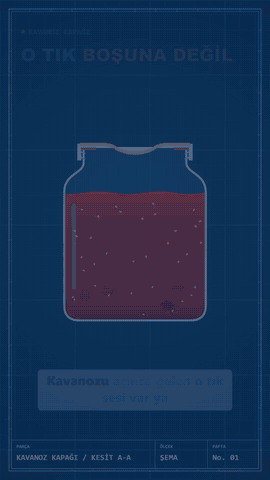
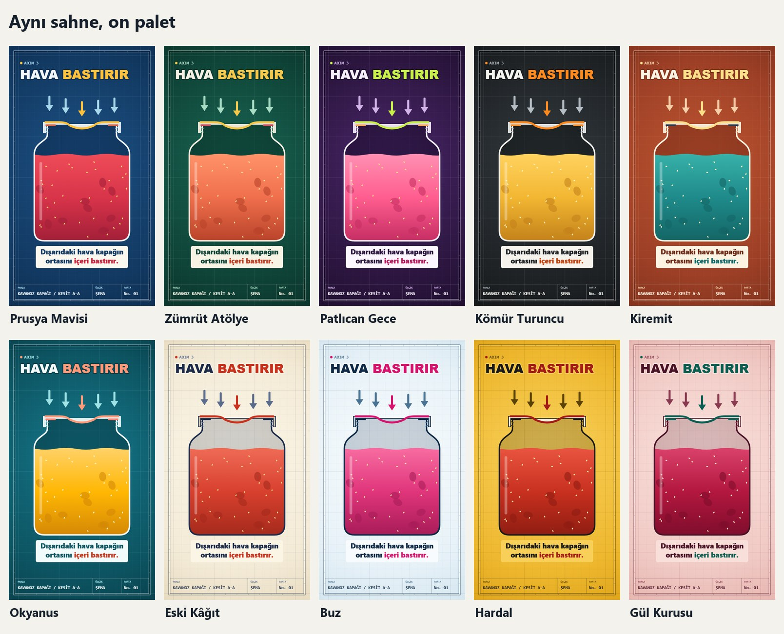
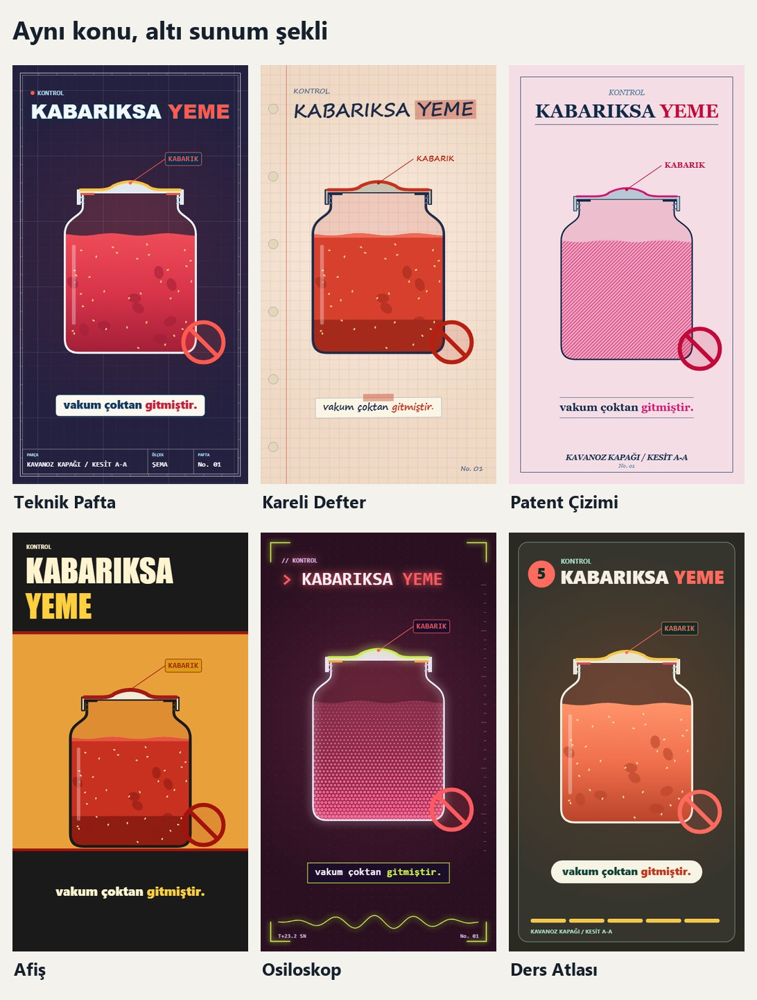

# Mekanizma Kesit Rehberi

Günlük eşyaların içindeki mekanizmayı kısa dikey videoyla anlatmak için kural dizini ve çalışan kod.



Bir konuyu bir kez çizersin. Aynı film 10 palet, 6 sunum şekli ve 3 kompozisyonla **132 uyumlu kombinasyonla** çıkar. Her videonun görünüşü değişir, tarzı değişmez.

## Yapay zekâyla kullanım: hazır promptlar

Claude Code, Codex, Cursor gibi dosya okuyup komut çalıştırabilen bir yapay zekâ aracıyla kullan. Sohbet penceresine link yapıştırmak yetmez: video bilgisayarında çizilir.

**1. Kurulum ve örnek video** (ilk seferde bunu ver):

```text
https://github.com/TR-KOBRA/mekanizma-kesit-rehberi reposunu klonla ve AGENTS.md dosyasındaki talimatlara harfiyen uy. "bash kur.sh" ile kur, sonra "bash video.sh kesitornek" ile örnek kavanoz videosunu üret ve bana göster. Kendi animasyon kodunu yazma, sadece repodaki kiti ve komutları kullan.
```

**2. Aynı videonun başka renk ve şekli:**

```text
AGENTS.md'ye uyarak örnek filmi şu kombinasyonla yeniden üret: palet okyanus, şekil poster, kompozisyon ikiz. Sadece video.sh komutunu kullan.
```

**3. Yeni konu:**

```text
AGENTS.md'deki "Yeni konu" adımlarıyla "<KONU>" hakkında bir mekanizma videosu yap.
- Önce iki kaynakla doğrulanmış bilgi notunu ve 50-130 kelimelik metni bana onaylat.
- Seslendirme dosyam: <DOSYA YOLU>. Müzik: <DOSYA YOLU>. Kelime zamanlarını araclar/kelimeler.py ile çıkar.
- Kombinasyonu araclar/sec.py ile seç.
- "bash yeni.sh" ile örnek filmi kopyala. Sadece nesneyi, sahneleri, CAP, ANTET ve DURATION'ı değiştir. Renklere, yazılara, çerçeveye ve kite dokunma.
- Videodan önce kontak sayfasını göster, sonra video.sh ile videoyu üret.
```

## Neden videodaki gibi olmadı?

| Belirti | Neden | Çözüm |
|---|---|---|
| Bambaşka bir çizim çıktı | Yapay zekâ kendi animasyon kodunu yazdı | Promptta AGENTS.md'yi şart koş, "kendi kodunu yazma" de |
| Hiç video çıkmadı | Motor kurulmadı | `bash kur.sh` çalıştır, eksik programı kur |
| Yazılar biraz farklı | Mac ya da Linux: Segoe UI ve Consolas yok | Bilinen fark. En yakın yazı tipi kullanılır |
| Video sessiz | Repoda ses ve müzik yok | `video.sh` komutuna `--ses` ve `--muzik` ver |
| Altyazı sesle kayıyor | Kelime zamanları tahmin edildi | `python araclar/kelimeler.py <ses>` |
| Renkler karışık | Film içine renk kodu yazıldı | Renkler yalnız paletten, rol adıyla |

## Elle kurulum

Gerekenler: git, Node.js 20+, npm, ffmpeg, Python 3.9+. Windows'ta komutları Git Bash'te çalıştır.

```bash
git clone https://github.com/TR-KOBRA/mekanizma-kesit-rehberi.git
cd mekanizma-kesit-rehberi
bash kur.sh                       # anidoodle motorunu indirir ve kurar
bash video.sh kesitornek          # örnek video: cikti/kesitornek_prusya_pafta_tam.mp4
bash video.sh kesitornek --palet zumrut --sekil atlas --kompozisyon buyutec
bash yeni.sh buzdolabi            # yeni film dosyası: motor/src/canvas-core/buzdolabi.ts
```

Çizim motoru [anidoodle](https://github.com/alexgreensh/anidoodle). `kur.sh` bu kitin denendiği sürümü indirir.

## Görünüşler





Bütün kombinasyonlar: [matris](onizleme/matris.jpg), [dönüm anları](onizleme/sahneler.jpg), [kompozisyonlar](onizleme/kompozisyon_matris.jpg).

## Kural dizini

| Dosya | Ne anlatır |
|---|---|
| [01 Değişmezler](kurallar/01-degismezler.md) | Hangi kombinasyon seçilirse seçilsin bozulmayan kurallar |
| [02 Renk](kurallar/02-renk.md) | Renk rolleri, on palet, yeni palet ekleme |
| [03 Sunum şekilleri](kurallar/03-sunum-sekilleri.md) | Altı şekil, hangisi ne zaman, yeni şekil ekleme |
| [04 Kompozisyon](kurallar/04-kompozisyon.md) | Tam, büyüteç, ikiz ve altyazı seçenekleri |
| [05 Seçim ve tekrar](kurallar/05-secim-ve-tekrar.md) | Son videolara benzemeyen kombinasyon nasıl seçilir |
| [06 Konu ve metin](kurallar/06-konu-ve-metin.md) | Konu ölçütü, kanca, metin iskeleti, doğruluk |
| [07 Hareket ve ses](kurallar/07-hareket-ve-ses.md) | Kamera, zamanlama, müzik, ses seviyesi |
| [08 Yeni konu çizmek](kurallar/08-yeni-konu.md) | Kavanoz yerine başka bir nesne koymak |
| [09 Kontrol listesi](kurallar/09-kontrol-listesi.md) | Teslimden önce bakılacaklar |

## Komutlar

| Komut | Ne yapar |
|---|---|
| `bash kur.sh` | Motoru indirir, kiti kurar, deneme karesi çeker |
| `bash video.sh <film> [seçenekler]` | Filmi seçilen kombinasyonla videoya çevirir |
| `bash yeni.sh <ad>` | Örnek filmden yeni film dosyası açar |
| `python araclar/sec.py "konu"` | Son videolara benzemeyen kombinasyon önerir |
| `python araclar/sec.py --liste` | Kombinasyon sayısını ve geçmişi gösterir |
| `python araclar/kelimeler.py <ses>` | Seslendirmeden altyazı zamanlarını çıkarır (faster-whisper ister) |
| `python araclar/miks.py <ses> <muzik> <sure> <cikti>` | Anlatım, müzik ve dönüm seslerini karıştırır |
| `python araclar/kontrast.py` | Her paletin okunurluğunu ölçer |
| `python araclar/kur.py <film klasörü>` | Kiti başka bir anidoodle film klasörüne kurar |

## Klasörler

| Klasör | İçinde |
|---|---|
| `kurallar/` | Kural dizini |
| `temalar/` | `paletler.json`, `sekiller.json`, `kullanilanlar.json` |
| `src/` | Konudan bağımsız kit: zemin, çerçeve, başlık, altyazı, gösterge, büyüteç |
| `ornek/` | Kavanoz filmi ve bütün kombinasyonları çizen vitrin |
| `araclar/` | Kurulum, seçim, zamanlama, miks, kontrast, önizleme |
| `onizleme/` | Örnek video ve önizleme görselleri |
| `motor/`, `cikti/` | Kurulumdan sonra oluşur, repoya girmez |

## Lisans

MIT. Çizim motoru anidoodle bu repoda yoktur, `kur.sh` indirir; motorun kendi lisansı geçerlidir.
