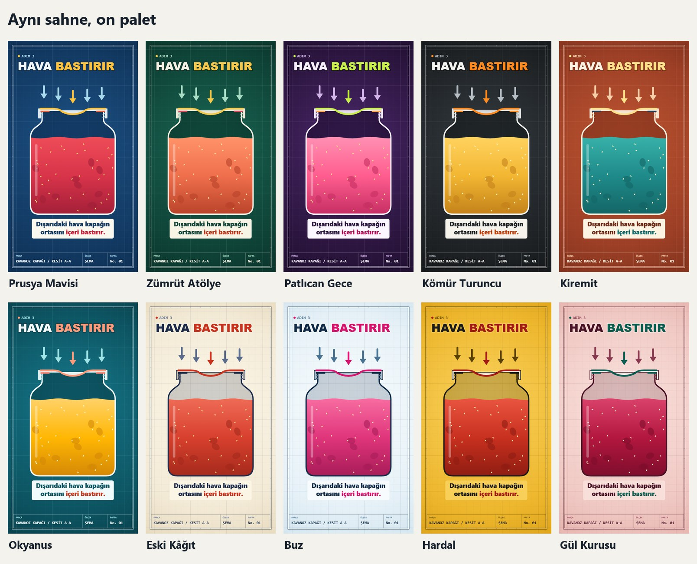

# 02 · Renk

Paletler `temalar/paletler.json` içindedir. Kod renk adı değil **rol** kullanır, bu yüzden palet değişince bütün film birlikte değişir.

## Roller

| Rol | Nerede kullanılır |
|---|---|
| `zemin`, `zemin2`, `isik` | Kâğıt, kenar koyuluğu, ortadaki aydınlık |
| `murekkep` | Ana çizgi ve başlığın ilk parçası |
| `cizgi` | İkincil çizgi, etiket, ızgara, oklar |
| `vurgu` | Başlığın ikinci parçası, hareket eden parça, en önemli ok |
| `dolgu`, `dolgu2`, `dolgu3` | Nesnenin içindeki madde: orta, koyu, açık |
| `detay` | Maddenin içindeki küçük parçalar |
| `metal`, `conta` | Kapak gövdesi, sızdırmazlık parçası gibi yapısal parçalar |
| `buhar` | Duman ve damla |
| `tehlike`, `tamam` | Yasak işareti ve onay işareti |
| `uyari_zemin`, `uyari_isik` | Son bölümün zemini |
| `yazi_zemin`, `yazi`, `yazi_vurgu` | Altyazı plakası ve afiş bantları |

## Oran

- Karenin çoğu zemin ailesidir.
- İkinci büyük alan dolgudur.
- Vurgu küçük kalır. Her yere vurgu koyarsan hiçbir yer vurgulanmış olmaz.

## On palet

| Anahtar | Ad | Tür | Uygun konular |
|---|---|---|---|
| `prusya` | Prusya Mavisi | Koyu | Mühendislik, güven |
| `zumrut` | Zümrüt Atölye | Koyu | Doğa, gıda, tarım, sağlık |
| `patlican` | Patlıcan Gece | Koyu | Genç, teknoloji, gizemli konular |
| `komur` | Kömür Turuncu | Koyu | Makine, araba, ağır sanayi |
| `kiremit` | Kiremit | Koyu | Ev, mutfak, yerel, sıcak konular |
| `okyanus` | Okyanus | Koyu | Su, hava, fizik, temizlik |
| `eskikagit` | Eski Kâğıt | Açık | Tarih, icat, belgesel |
| `buz` | Buz | Açık | Temizlik, tıp, soğutma, elektronik |
| `hardal` | Hardal | Açık | Uyarı, sokak, trafik |
| `gul` | Gül Kurusu | Açık | Bakım, ev hayatı, yumuşak konular |

## Konuya göre dolgu

Paletin dolgusu nesnenin gerçek rengiyle çelişiyorsa filmde yalnız `dolgu` üçlüsünü değiştir. Süt mavi, zeytinyağı kırmızı olmaz. Değişiklikten sonra kontrast ölçümünü yeniden çalıştır.

## Okunurluk eşikleri

`python araclar/kontrast.py` şu oranları ölçer. Bir eşik tutmazsa palet kullanılmaz.

| Ne | Renkler | En az |
|---|---|---|
| Ana çizgi, başlık | `murekkep` / `zemin` | 4,5 |
| Uyarı başlığı | `murekkep` / `uyari_zemin` | 4,5 |
| Altyazı | `yazi` / `yazi_zemin` | 4,5 |
| Açık palet altyazı plakası | `murekkep` / `isik` | 4,5 |
| İnce çizgi, etiket | `cizgi` / `zemin` | 3 |
| Vurgulu başlık | `vurgu` / `zemin` | 3 |
| Uyarı kelimesi | `tehlike` / `uyari_zemin` | 3 |
| Onay işareti | `tamam` / `zemin` | 3 |
| Altyazı vurgusu | `yazi_vurgu` / `yazi_zemin` | 3 |
| Açık palet altyazı vurgusu | `vurgu` / `isik` | 3 |
| Nesne zeminden ayrılıyor mu | `dolgu` / `zemin` | 1,6 |

## Yeni palet ekleme

1. `paletler.json` içinde en yakın paleti kopyala, yeni anahtar ver. Anahtar ASCII ve küçük harf olsun.
2. `koyu` alanını doğru yaz. Şekil uyumu buna bakar.
3. Dolgu rengini zeminin karşı tarafından seç: soğuk zemine sıcak dolgu, sıcak zemine soğuk dolgu.
4. `python araclar/kontrast.py` çalıştır.
5. Vitrini üretip kareye gözle bak. Ölçüm geçmesi güzel göründüğünü kanıtlamaz.
