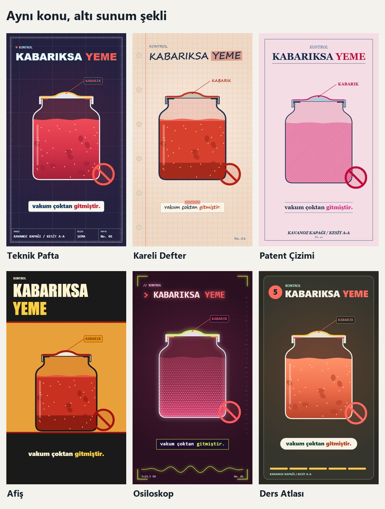

# 03 · Sunum şekilleri

Şekil, aynı tarzın farklı kılığıdır. Zemini, çerçeveyi, başlığı, altyazıyı, çizgi karakterini ve dolgu tekniğini birlikte değiştirir. Tanımlar `temalar/sekiller.json` içindedir.

## Altı şekil

| Anahtar | Ad | Zemin | Başlık | Dolgu | Çizgi | Palet |
|---|---|---|---|---|---|---|
| `pafta` | Teknik Pafta | Kayan ızgara, antet | Kalın, konturlu | Kademeli | Cetvel | Hepsi |
| `kareli` | Kareli Defter | Kareli kâğıt, delikler, kırmızı marj | El yazısı, fosforlu kalem | Düz | Titrek el çizgisi | Açık |
| `patent` | Patent Çizimi | Düz kâğıt, ince çerçeve | Tırnaklı, ortalı | Çizgi tarama | İnce | Açık |
| `poster` | Afiş | İki bantlı | Dev, iki satır | Düz | Kalın | Hepsi |
| `osiloskop` | Osiloskop | Nokta ızgara, köşe işaretleri, canlı sinyal | Daktilo gibi yazılır | Raster nokta | Parlayan | Koyu |
| `atlas` | Ders Atlası | Yuvarlak kart, adım çubuğu | Numaralı rozet | Kademeli | Cetvel | Hepsi |

## Hangisi ne zaman

| Konu | Önce bunu dene |
|---|---|
| Makine, cihaz | `pafta` |
| Okul ve ev bilgisi, samimi anlatım | `kareli` |
| İcat, "bunu kim buldu" | `patent` |
| En sert "yanlış biliyorsun" kancası | `poster` |
| Elektrik, ses, sinyal, dijital | `osiloskop` |
| Sayılı adımlarla anlatılan süreç | `atlas` |

## Şeklin kuralları

- `alan.ust` ve `alan.alt` nesnenin yaşadığı bölgedir. Afişte üst bant büyük olduğu için nesne aşağı iner.
- `uyum` değeri `koyu`, `acik` ya da `hepsi` olur. `kur.py` uymayan eşleşmeyi reddeder.
- Parlama yalnız `osiloskop` içindir. Başka şekle parlama ekleme.
- Titrek çizgi yalnız `kareli` içindir, saniyede 6 kez değişir. Daha hızlısı rahatsız eder.
- Tarama ve raster dolguda maddenin küçük parçaları çizilmez. Doku zaten dolgunun kendisidir.

## Dönüm anlarında

Şekilleri tek kareye bakarak seçme. Kanca, sıcak, soğuma, açılış ve tık anlarının hepsi [bu sayfada](../onizleme/sahneler.jpg) durur.

## Yeni şekil ekleme

1. `sekiller.json` içinde en yakın şekli kopyala.
2. Yeni görünüm gerekiyorsa `src/kesitKit.ts` içinde `zemin`, `cerceve`, `baslik` ya da `altyazi` işlevine yeni tip ekle.
3. `uyum` ve `varsayilan_palet` alanlarını doldur.
4. Vitrini üretip matristeki bütün satırına bak.
5. Bu dosyadaki tabloya ekle.

Şekil eklerken ölçüt şu olsun: küçük resimde bile diğerlerinden ayırt ediliyor mu? Ayırt edilmiyorsa o yeni şekil değil, palet farkıdır.
