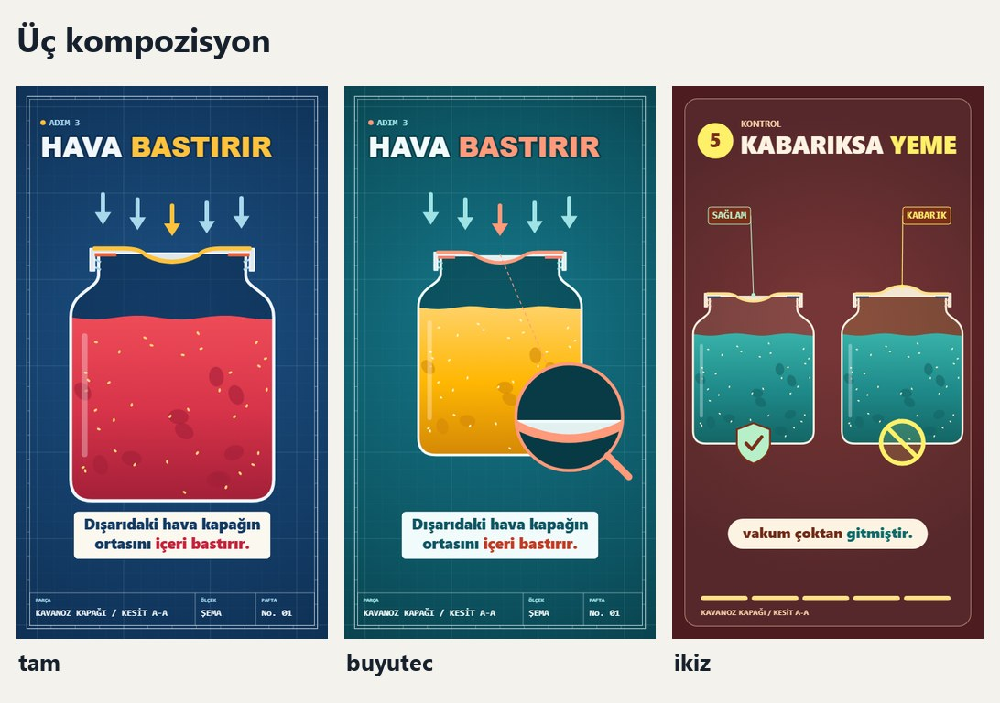
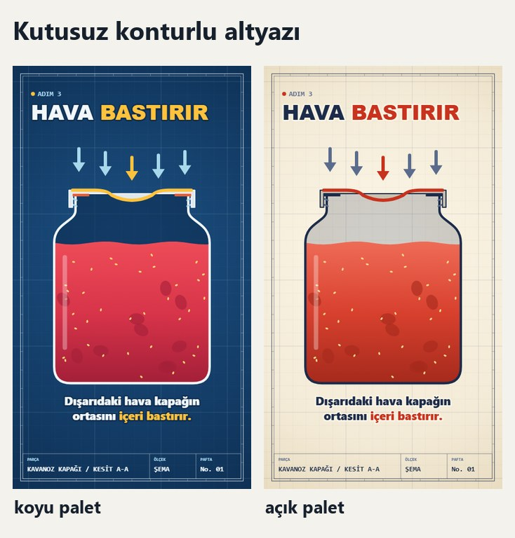

# 04 · Kompozisyon

Kompozisyon, filmin dönüm sahnesinin nasıl kurulduğunu belirler. Palet ve şekilden bağımsızdır.



| Anahtar | Ne yapar | Ne zaman |
|---|---|---|
| `tam` | Kamera nesneye yaklaşır | Mekanizma nesnenin tamamını ilgilendiriyorsa |
| `buyutec` | Nesne yerinde kalır, küçük parça mercekte büyür | Asıl olay küçük bir parçadaysa |
| `ikiz` | İki nesne yan yana: sağlam ve bozuk | Konu "şöyleyse iyi, böyleyse kötü" diye bitiyorsa |

## Büyüteç

- Mercek nesnenin yanına, altyazı bandına değmeyecek yere gelir.
- Noktalı çizgi merceği gerçek parçaya bağlar.
- Mercekte gösterilen şey asıl sahnenin aynısıdır, ayrı çizim değildir. Kodda aynı `sahne` işlevi iki kez çağrılır.
- Bir filmde en fazla bir kez kullanılır.

## İkiz

- Sol iyi, sağ kötüdür. Bütün seride bu sıra korunur.
- İki nesne de aynı boyuttadır. Fark yalnız incelenen parçadadır.
- Etiketler kısa tutulur: `SAĞLAM`, `KABARIK`.
- İşaretler altyazı bandına taşmaz. Örnek filmde bu sınır hesaplanır.

## Altyazı seçeneği

Her şeklin kendi altyazısı vardır. Kutusuz yazı istenirse:

```bash
python araclar/kur.py <film_klasoru> --palet prusya --sekil pafta --altyazi kontur
```



Bütün şekillerde iki kompozisyonun görünümü [bu sayfada](../onizleme/kompozisyon_matris.jpg).
